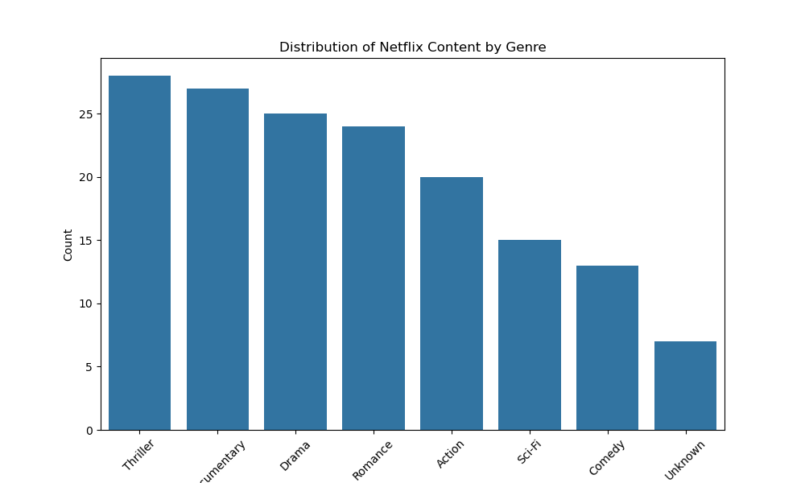
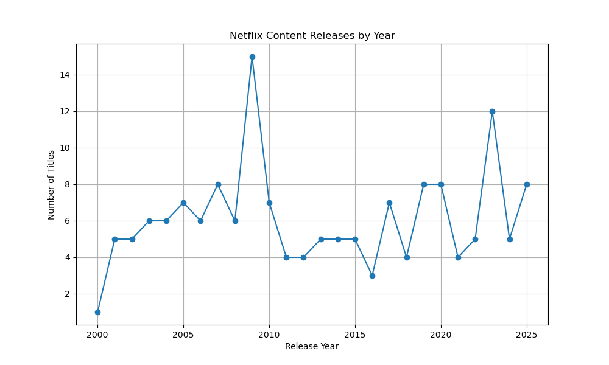

🎬 Netflix Content Analysis Dashboard

Python | Pandas | NumPy | Data Analysis | Visualization

📌 Project Overview

Netflix manages a vast and diverse content library across genres, countries, and release years.
The goal of this project is to analyze Netflix’s content catalog to uncover content distribution patterns, growth trends, and genre insights that could support content strategy and decision-making.

This project simulates a real-world data analyst task: transforming raw content data into actionable insights using Python.

🎯 Business Problem

How is Netflix’s content distributed across genres and countries?

How has content production evolved over time?

Which genres dominate the platform?

How can analysts quickly explore content trends without manual analysis?

🛠 Approach & Methodology
1️⃣ Data Cleaning & Preparation

Handled missing values and duplicate records

Standardized date and categorical fields

Ensured data consistency for analysis

2️⃣ Exploratory Data Analysis (EDA)

Analyzed content distribution by:

Genre

Release year

Country

Identified trends in content growth over time

Compared content patterns across regions

3️⃣ Data Visualization & Dashboarding

Built clear and intuitive visualizations:

Genre distribution (bar charts)

Content growth by year (line charts)

Ratings by country (interactive charts)

Developed an interactive dashboard using Dash to filter content by genre and explore trends dynamically

📊 Key Insights

Certain genres dominate Netflix’s catalog, indicating strong content focus areas

Content production has increased significantly in recent years, reflecting platform growth

Genre distribution varies by country, highlighting regional content preferences

(Insights can guide content acquisition, regional strategy, and audience targeting decisions.)

📈 Sample Visualizations

Release Trend Over Time

🧰 Tools & Technologies

Programming: Python

Libraries: Pandas, NumPy, Matplotlib, Seaborn, Plotly, Dash

Analysis: Data Cleaning, EDA, Trend Analysis

Visualization: Static & Interactive Dashboards

## Files
- netflix_analysis.ipynb: Jupyter Notebook with code.
- netflix_data.csv: Dataset with 250 rows.
- genre_distribution.png: Bar chart.
- release_trend.png: Line chart.
- ratings_by_country.html: Interactive Plotly chart.

## How to Run
1. Install dependencies: `pip install pandas matplotlib seaborn plotly dash`.
2. Run `netflix_analysis.ipynb` in VS Code.
3. Open `ratings_by_country.html` or run the Dash app for the dashboard.